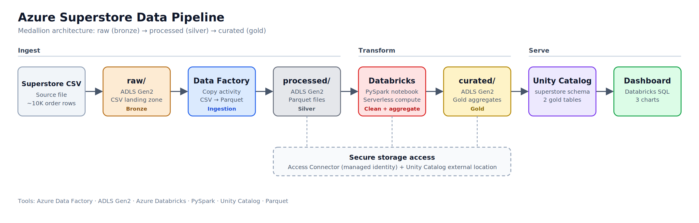
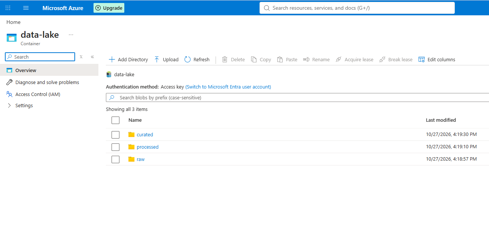
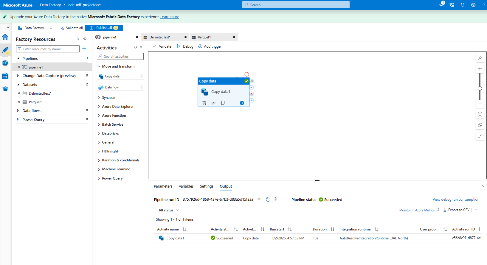
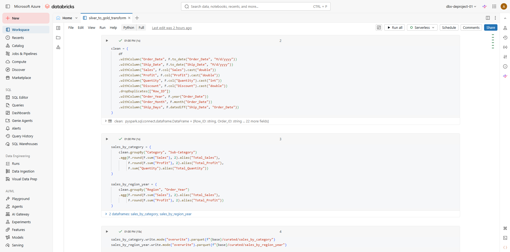
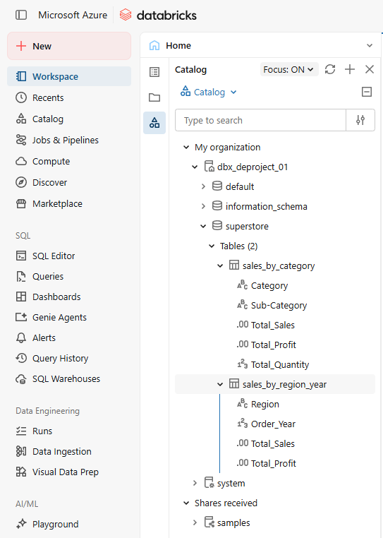
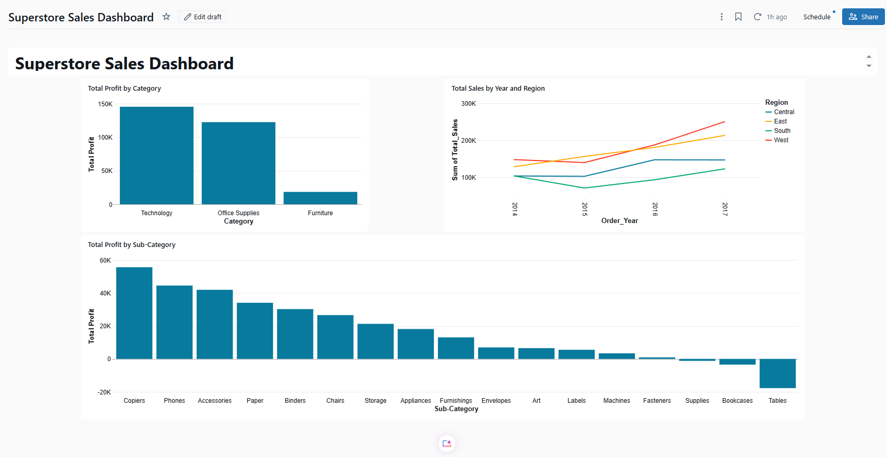
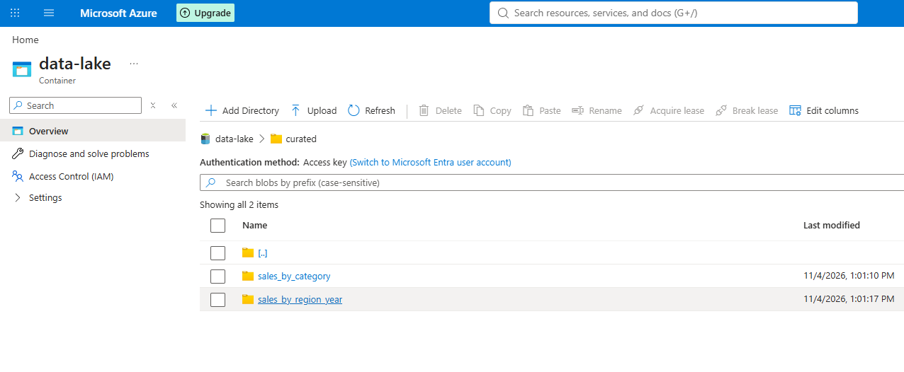

# Azure Superstore Data Pipeline

End-to-end data engineering project using Azure Data Factory, ADLS Gen2,
and Azure Databricks, following the medallion architecture
(raw → processed → curated).

## Architecture



CSV → Azure Data Factory → ADLS Gen2 (raw → processed) →
Databricks (PySpark) → ADLS Gen2 (curated) → Unity Catalog tables → Dashboard

## Tech Stack

Azure Data Factory, ADLS Gen2, Azure Databricks (serverless), PySpark,
Unity Catalog, Parquet, Databricks SQL Dashboards

## Pipeline Steps

1. **Ingest:** ADF copies the Superstore CSV from `raw` and converts it to
   Parquet in `processed`.
2. **Transform:** A PySpark notebook casts data types, parses dates,
   removes duplicates, and adds year, month, and shipping-days columns.
3. **Aggregate:** Builds two gold datasets, sales by category/sub-category
   and sales by region/year, and writes them to `curated`.
4. **Serve:** Tables are registered in Unity Catalog and visualised in a
   Databricks dashboard.

## Challenges Solved

- **CSV parsing error:** quoted product names containing commas and inch
  marks broke the ADF source; fixed by setting the escape character to a
  double quote.
- **Parquet column names:** Parquet rejects spaces in column names; renamed
  columns in the Copy activity mapping.
- **Serverless Databricks:** no classic clusters were available, so I used
  serverless compute and secured storage access with an Access Connector
  (managed identity) and a Unity Catalog external location.

## Key Insights

- Technology is the most profitable category, followed by Office Supplies;
  Furniture lags far behind.
- Copiers, Phones, and Accessories are the top sub-categories by profit,
  while Tables, Bookcases, and Supplies are loss-making.
- West and East show the strongest sales growth from 2014 to 2017.

## Screenshots

### Data lake structure (raw → processed → curated)


### Azure Data Factory pipeline (successful run)


### Databricks transformation notebook


### Gold tables in Unity Catalog


### Dashboard


### Curated output in storage


## Repository Structure

```text
notebooks/   PySpark transformation notebook
adf/         ADF pipeline definition (JSON)
data/        Sample dataset
docs/        Screenshots
```
